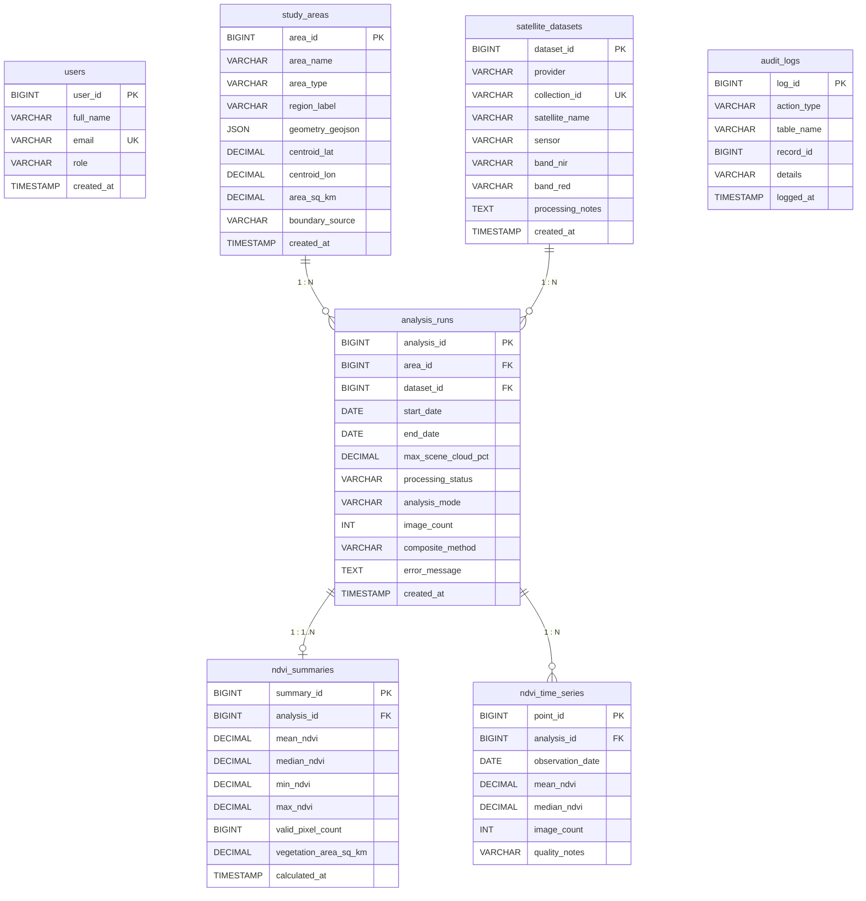

# Relational Database Design & Architecture
## Pune Vegetation Monitoring & Remote-Sensing Database System

### 1. Database Model Overview
The system implements a normalized **MySQL 8.0** relational database.
- **Database Name**: `pune_vegetation_db`
- **Storage Engine**: `InnoDB` (ACID compliant, foreign keys, row-level locking)
- **Character Set**: `utf8mb4` with `utf8mb4_unicode_ci`

---

### 2. Normalization & Design Principles

#### Third Normal Form (3NF) Compliance
1. **1NF**: Every column contains atomic values; no repeating groups. Geometry is stored as single JSON objects; individual temporal observations reside in dedicated rows in `ndvi_time_series`.
2. **2NF**: No partial dependencies; all non-key attributes are fully functionally dependent on primary keys.
3. **3NF**: No transitive dependencies. Satellite specifications (e.g. `satellite_datasets`) are decoupled from run executions (`analysis_runs`). Area geometries and properties live in `study_areas` rather than duplicating geographic attributes across runs.

#### Constraints & Domain Integrity
- **Foreign Keys**: Enforced referential integrity.
  - Deleting an analysis cascades to its summaries and time-series points (`ON DELETE CASCADE`).
  - Deleting a study area or dataset with linked runs is restricted (`ON DELETE RESTRICT`).
- **Check Constraints**:
  - `start_date <= end_date`
  - `max_scene_cloud_pct BETWEEN 0 AND 100`
  - `mean_ndvi BETWEEN -1.0 AND +1.0`
  - `processing_status IN ('pending', 'running', 'completed', 'failed')`
  - `analysis_mode IN ('real_gee', 'demo')`

#### Index Optimization
- `idx_time_series_analysis_date`: Composite index on `(analysis_id, observation_date)` allows $O(\log N)$ range-based queries for rendering time-series plots.
- Unique constraint `uq_analysis_obs_date` prevents duplicate observation rows for the same analysis date.
- Foreign key indexes on `area_id` and `dataset_id` speed up multi-table JOINs.

---

### 3. Transaction Management (ACID)
When an analysis completes, results must not be partially saved. The system wraps:
1. `INSERT INTO analysis_runs`
2. `INSERT INTO ndvi_summaries`
3. `INSERT INTO ndvi_time_series (batch)`

inside a single transaction (`START TRANSACTION ... COMMIT`). If an exception or constraint violation occurs during batch insertion, a `ROLLBACK` is triggered, keeping the database in a consistent state.
